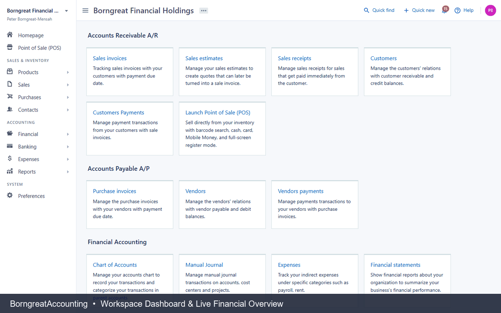
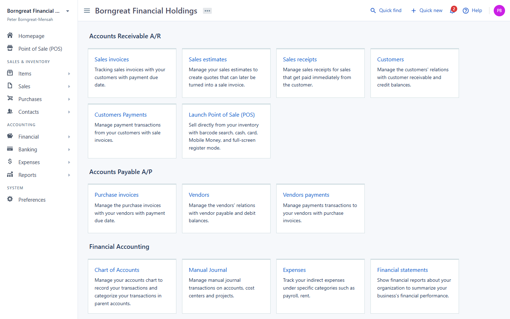
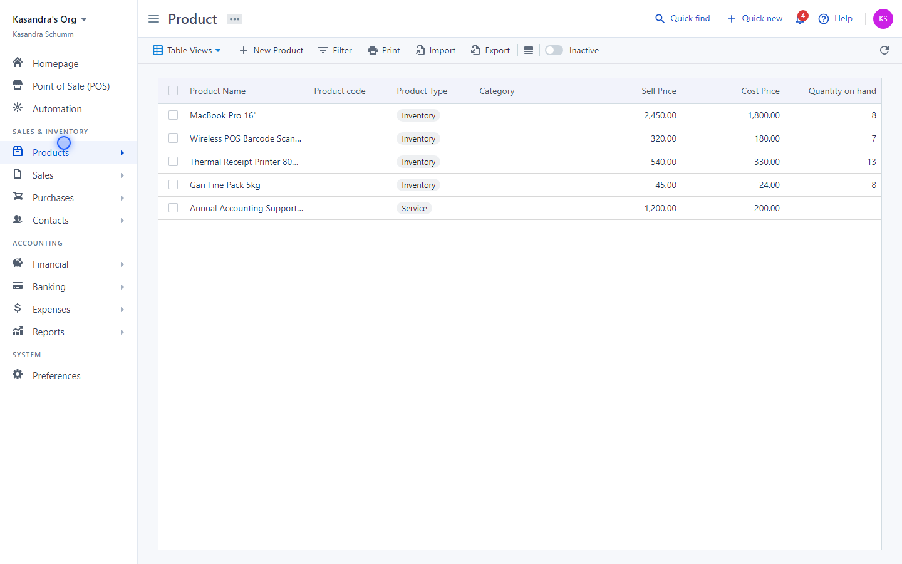
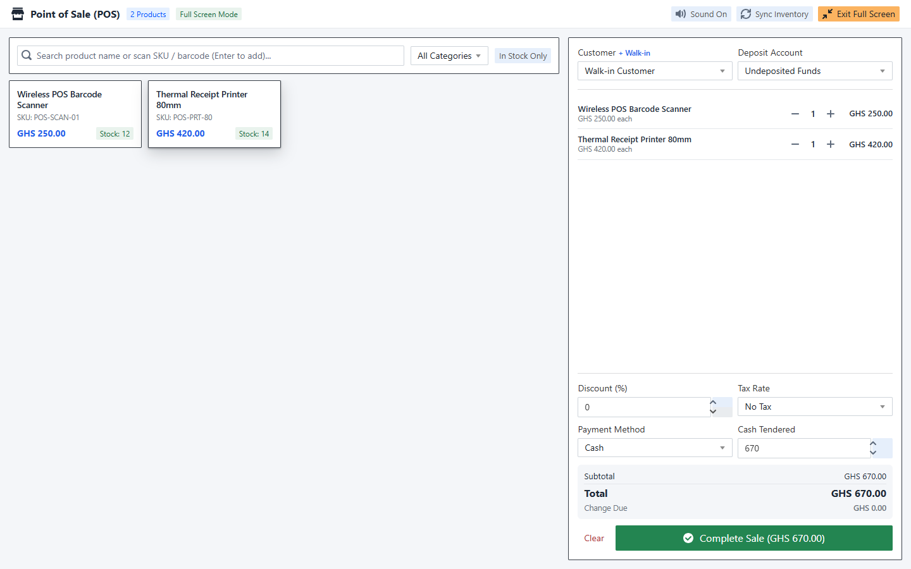
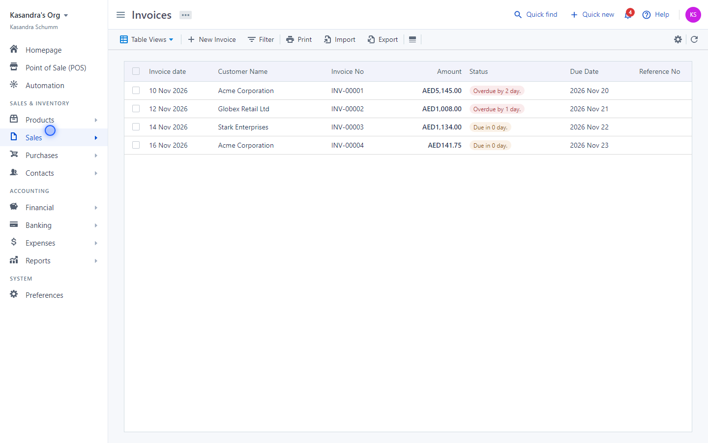
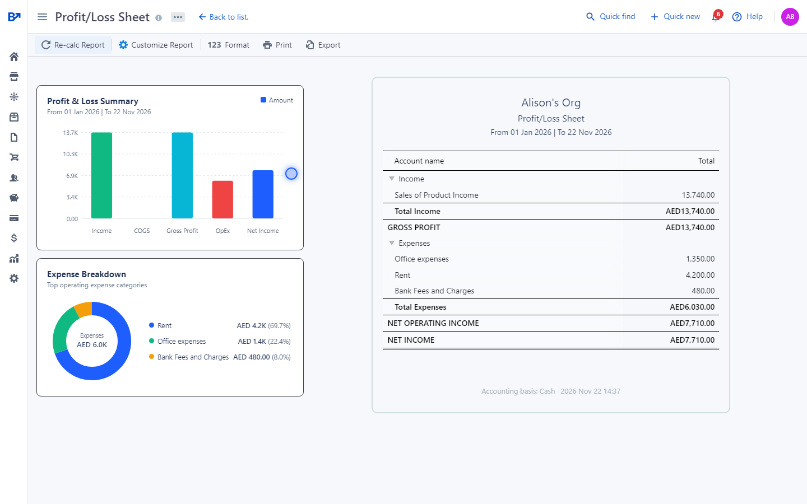
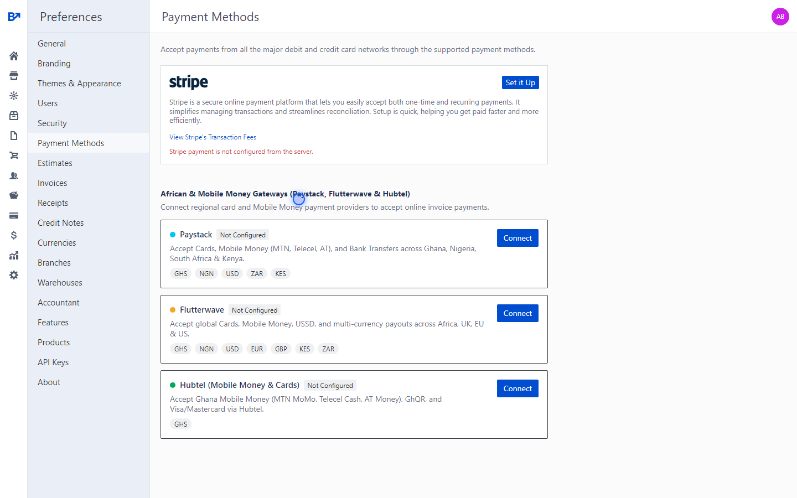
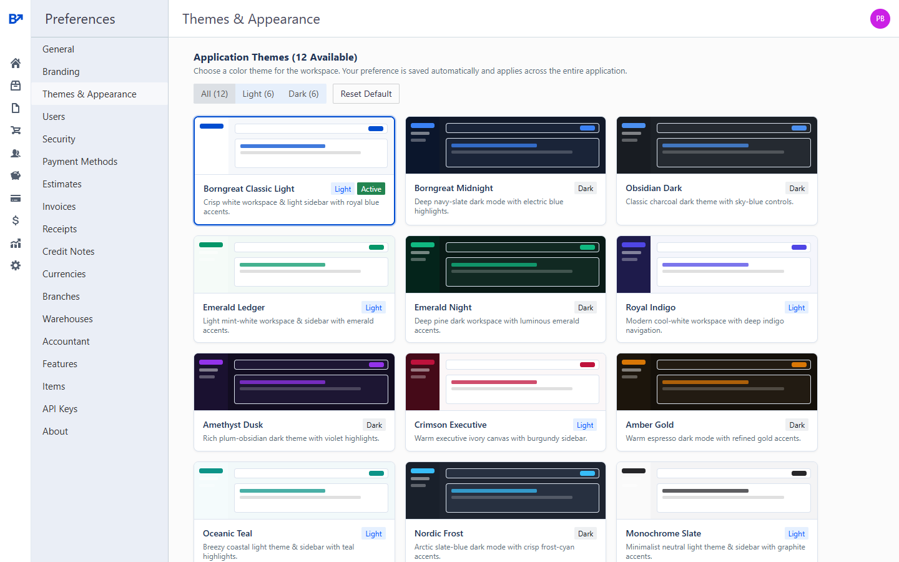
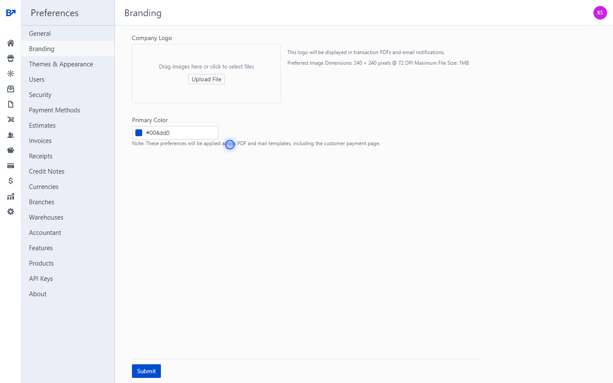
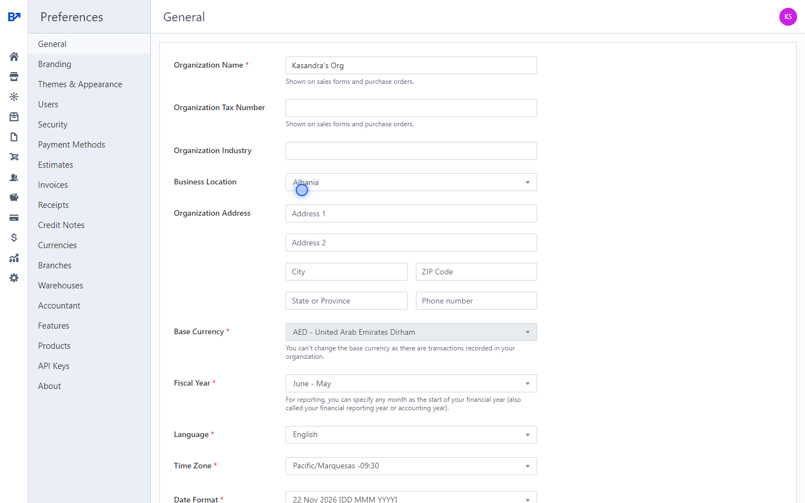

<p align="center">
  
</p>

<h1 align="center">BorngreatAccounting (BtAccounting)</h1>
<p align="center"><strong>Your Accounting. Your Servers. Your Control. (Quickbooks Alternative)</strong></p>

<p align="center">
  <a href="LICENSE"></a>
  <a href="https://github.com/PipetteGh/borngreataccounting/actions"></a>
  <a href="docs/DOCKER-DEPLOYMENT.md"></a>
  <a href="docs/WINDOWS-INSTALLATION.md"></a>
  <a href="https://github.com/sponsors/PipetteGh"></a>
  <!-- ALL-CONTRIBUTORS-BADGE:START - Do not remove or modify this section -->
  <a href="#contributors"></a>
  <!-- ALL-CONTRIBUTORS-BADGE:END -->
</p>

**BorngreatAccounting** (`BtAccounting`) is a full-featured, self-hosted, multi-tenant, double-entry accounting and financial management platform designed for small, medium, and enterprise businesses. Run it on your own Linux servers, Docker/Kubernetes infrastructure, cloud VMs, or Windows workstations with complete data sovereignty.

---

## Key Capabilities

- **True Double-Entry Accounting Engine**: Full Chart of Accounts, manual & recurring Journal Entries, General Ledger, Trial Balance, Balance Sheet, Profit & Loss (Income Statement), and Cash Flow Statement.
- **Receivables & Sales**: Customer management, Estimates/Quotes, Sale Invoices, Recurring Invoices, Sale Receipts, Credit Notes, Payment Received, Online Payment Portals, and PDF/Email invoicing.
- **Point of Sale (POS) & Inventory Register**: Dedicated touch-friendly POS register (`/pos`) with barcode/SKU search, category filtering, live inventory stock validation, automatic stock deduction & double-entry receipt posting, cash change calculation, receipt printing, and distraction-free **Full-Screen Mode**.
- **Payment Gateways & Mobile Money**: Built-in per-tenant integrations for **Stripe**, **Paystack** (Cards, MTN/Telecel/AT Mobile Money, Bank Transfers across GHS, NGN, USD, ZAR, KES), **Flutterwave** (Cards, Mobile Money, USSD across Africa, UK, EU & US), and **Hubtel** (Ghana Mobile Money, GhQR & Visa/Mastercard) with webhook signature verification.
- **Themes & White-Label Branding**: Choose from **12 built-in Light & Dark themes** with live preview, plus custom company logo upload and primary brand color configuration for PDFs and emails.
- **Payables & Purchases**: Vendor management, Purchase Bills, Expenses, Vendor Credit Notes, Payment Made, and AP Aging reports.
- **Inventory & Warehouses**: Multi-warehouse inventory tracking, inventory adjustments, warehouse transfers, low-stock reorder point alerts, and inventory valuation reports.
- **Banking & Cash Flow**: Bank & cash accounts, Plaid bank feeds, uncategorized transaction rules, and account reconciliation.
- **Global Multi-Currency & Tax Presets**: Supports 150+ ISO currencies (`USD`, `EUR`, `GBP`, `GHS`, `TRY`, `CAD`, `AUD`, `NGN`, `KES`, `ZAR`, etc.) with live exchange rate syncing and optional country tax localization presets (including Ghana GRA VAT/NHIL/GETFund/CHRL, UK HMRC VAT, EU VAT, Türkiye KDV, and US Sales Tax).
- **Enterprise Multi-Tenancy & Security**: Per-organization isolated MariaDB tenant databases, Role-Based Access Control (RBAC), TOTP Two-Factor Authentication (2FA) with recovery codes, API Keys, and Audit Trails.

---

## Application Overview



---

## Screenshots

### Workspace Dashboard


### Products & Inventory


### Point of Sale (POS) & Full-Screen Register


### Sales & Invoices


### Financial Reports (Profit & Loss)


### Payment Gateways (Stripe, Paystack, Flutterwave & Hubtel)


### Themes & Appearance (12 Light & Dark Themes)


### Company Branding & Logo Upload


### Organization Settings


---

## System & Platform Requirements

| Platform | OS / Environment | Required Software & Runtime | Hardware Minimum |
|---|---|---|---|
| **Windows** | Windows 10 / 11 (64-bit), Windows Server 2019/2022 | **Desktop EXE / Native**: PowerShell 5.1+, `curl.exe`, .NET Framework 4.x+ (built into Windows). The self-healing runtime auto-installs **Node.js**, **MariaDB 10.11**, and **Redis** if missing.<br>**Container Mode**: Docker Desktop `4.25+` (WSL2 backend) | 2 vCPU, 4 GB RAM (8 GB recommended), 20 GB SSD |
| **Linux** | Ubuntu 22.04 / 24.04 LTS, Debian 12+, RHEL / Rocky / AlmaLinux 9+ | `bash`, `curl`, `openssl`, `git`, `tar`, Docker Engine `24.0+`, Docker Compose `v2.20+` (`install.sh` auto-installs missing Docker/CLI prerequisites) | 2+ vCPU, 4 GB RAM (8–16 GB recommended), 20–60+ GB SSD |
| **macOS** | macOS 13 (Ventura) or newer (Apple Silicon & Intel) | Docker Desktop `4.25+` (for containers), or **Node.js 18.x+**, `pnpm 9.x`, **MariaDB 10.11**, **Redis** (for source dev) | 2+ vCPU, 8 GB RAM, 20 GB SSD |
| **Web Browser** | Desktop & Tablet | Google Chrome `100+`, Microsoft Edge `100+`, Mozilla Firefox `100+`, or Apple Safari `16+` with JavaScript & `localStorage` enabled | 1280×720+ display recommended |
| **Source / Dev** | Windows, Linux, or macOS | **Node.js `18.x LTS+`**, **`pnpm 9.0.5`**, **MariaDB `10.11`**, **Redis**, **Gotenberg** (optional, for PDF rendering), **S3 / Garage** (optional; falls back to local disk storage) | 4 GB RAM, 20 GB free disk |

---

## Quick Start (One-Command Self-Hosted Deployment)

### Linux / macOS
```bash
# Option A: Clone repository
git clone https://github.com/PipetteGh/borngreataccounting.git
cd borngreataccounting
chmod +x install.sh
./install.sh

# Option B: Download release archive via curl (v1.0.1)
curl -fsSL -L https://github.com/PipetteGh/borngreataccounting/archive/refs/tags/v1.0.1.tar.gz -o borngreataccounting-1.0.1.tar.gz
tar -xzf borngreataccounting-1.0.1.tar.gz
cd borngreataccounting-1.0.1
chmod +x install.sh
./install.sh
```

### Windows (One-Click `.exe` Installer or PowerShell)

[](https://github.com/PipetteGh/borngreataccounting/releases/latest/download/BorngreatAccounting-Setup.exe)

1. Click **[Download BorngreatAccounting-Setup.exe](https://github.com/PipetteGh/borngreataccounting/releases/latest/download/BorngreatAccounting-Setup.exe)** to download the standalone Windows installer.
2. Run `BorngreatAccounting-Setup.exe` and click **`1. Initialize / Install`** — it automatically downloads the app into `%LOCALAPPDATA%\BorngreatAccounting`, installs portable Node.js, MariaDB 10.11, and Redis if missing, builds and migrates the database, creates Desktop & Start Menu shortcuts, and launches the dashboard at `http://localhost:4100`.

```powershell
# Option A: Download latest standalone Windows Setup EXE via curl
curl.exe -fsSL -L https://github.com/PipetteGh/borngreataccounting/releases/latest/download/BorngreatAccounting-Setup.exe -o BorngreatAccounting-Setup.exe
.\BorngreatAccounting-Setup.exe

# Option B: Clone repository and run PowerShell installer
git clone https://github.com/PipetteGh/borngreataccounting.git
cd borngreataccounting
.\install.ps1
```

---

## Prebuilt Container Images (GHCR)

| Service | Image | Package Page |
|---|---|---|
| Web Frontend (SPA + Nginx) | `ghcr.io/pipettegh/borngreataccounting-web:latest` | [View Package](https://github.com/PipetteGh/borngreataccounting/pkgs/container/borngreataccounting-web) |
| Backend API & Migrator | `ghcr.io/pipettegh/borngreataccounting-api:latest` | [View Package](https://github.com/PipetteGh/borngreataccounting/pkgs/container/borngreataccounting-api) |
| Background Queue Worker | `ghcr.io/pipettegh/borngreataccounting-worker:latest` | [View Package](https://github.com/PipetteGh/borngreataccounting/pkgs/container/borngreataccounting-worker) |

```bash
docker pull ghcr.io/pipettegh/borngreataccounting-web:latest
docker pull ghcr.io/pipettegh/borngreataccounting-api:latest
docker pull ghcr.io/pipettegh/borngreataccounting-worker:latest
```

---

## Documentation Index

| Guide | Description |
|---|---|
| [Installation Overview](docs/INSTALLATION.md) | System requirements and deployment choices |
| [Docker Deployment Guide](docs/DOCKER-DEPLOYMENT.md) | Production Docker Compose & GHCR setup |
| [Windows Installation Guide](docs/WINDOWS-INSTALLATION.md) | Windows `.exe` Desktop Control Center & Docker Desktop setup |
| [Linux Server Deployment](docs/LINUX-DEPLOYMENT.md) | Ubuntu/Debian production server setup with TLS reverse proxy |
| [Configuration Reference](docs/CONFIGURATION.md) | Complete `.env` environment variable reference |
| [Backup & Restore Guide](docs/BACKUP-AND-RESTORE.md) | Automated backups, checksum verification, and disaster recovery |
| [Upgrade Guide](docs/UPGRADE-GUIDE.md) | Zero-data-loss upgrades and schema migration workflow |
| [Security Guide](docs/SECURITY.md) | Secrets management, 2FA, RBAC, and hardening |
| [Troubleshooting Guide](docs/TROUBLESHOOTING.md) | Diagnostics and solutions for common issues |
| [System Architecture](docs/ARCHITECTURE.md) | Multi-tenant architecture, data flow, and tech stack |
| [Developer Guide](docs/DEVELOPMENT.md) | Local monorepo setup, building, testing, and contributing |
| [Licensing & Attribution](docs/LICENSING-AND-ATTRIBUTION.md) | GNU AGPL-3.0 compliance and open-source attribution |
| [Release Process](docs/RELEASE-PROCESS.md) | Tagging, CI/CD pipelines, GHCR, and Windows EXE releases |

---

## Product Metadata & Attribution

- **Product Name**: BorngreatAccounting (`BtAccounting`)
- **Product Category**: Accounting and Financial Software
- **Developer & Publisher**: Peter Borngreat-Mensah (`Peter Borngreat-Mensah`)
- **GitHub Organization / Account**: `soluotech`
- **Official Source Repository**: [https://github.com/PipetteGh/borngreataccounting](https://github.com/PipetteGh/borngreataccounting)
- **License**: [GNU Affero General Public License v3.0 (AGPL-3.0)](LICENSE)

---

## Support & Donate

If **BorngreatAccounting** helps your business or saves you time, consider supporting ongoing development:

<p>
  <a href="https://github.com/sponsors/PipetteGh">
    
  </a>
</p>

---

## Contributors

Thanks goes to these wonderful people ([emoji key](https://allcontributors.org/docs/en/emoji-key)):

<!-- ALL-CONTRIBUTORS-LIST:START - Do not remove or modify this section -->
<!-- prettier-ignore-start -->
<!-- markdownlint-disable -->
<table>
  <tbody>
    <tr>
      <td align="center" valign="top" width="14.28%"><a href="https://github.com/PipetteGh"><br /><sub><b>Peter Borngreat-Mensah</b></sub></a><br /><a href="https://github.com/PipetteGh/borngreataccounting/commits?author=PipetteGh" title="Code">💻</a> <a href="#design-PipetteGh" title="Design">🎨</a> <a href="https://github.com/PipetteGh/borngreataccounting/commits?author=PipetteGh" title="Documentation">📖</a> <a href="#ideas-PipetteGh" title="Ideas, Planning, & Feedback">🤔</a> <a href="#infra-PipetteGh" title="Infrastructure (Hosting, Build-Tools, etc)">🚇</a> <a href="#maintenance-PipetteGh" title="Maintenance">🚧</a></td>
    </tr>
  </tbody>
</table>

<!-- markdownlint-restore -->
<!-- prettier-ignore-end -->

<!-- ALL-CONTRIBUTORS-LIST:END -->

This project follows the [all-contributors](https://github.com/all-contributors/all-contributors) specification. Contributions of any kind welcome!
