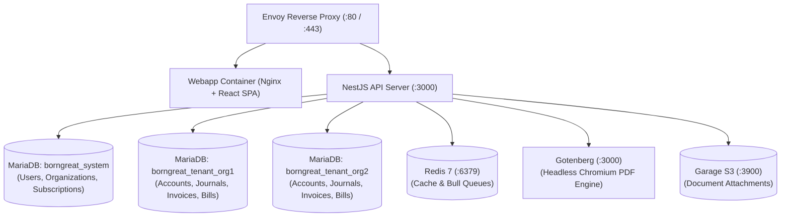

# System Architecture

**BorngreatAccounting (`BtAccounting`)** is a multi-tenant, modular financial accounting system built as a `pnpm` + `Lerna` TypeScript monorepo.

---

## Monorepo Package Structure

| Package | Path | Technology | Responsibility |
|---|---|---|---|
| `@borngreataccounting/server` | `packages/server` | NestJS, Knex.js, Objection.js, Bull, Passport JWT | Multi-tenant REST API, double-entry ledger engine, financial report generators, CLI migrations, background workers |
| `@borngreataccounting/webapp` | `packages/webapp` | React 18, Vite 5, BlueprintJS, Redux, React Query | Single-Page Application (SPA) accounting workspace |
| `@borngreataccounting/utils` | `shared/borngreataccounting-utils` | TypeScript (`tsup` CJS + ESM) | Centralized branding (`BRAND_CONFIG`), financial formatting, shared utilities |
| `@borngreataccounting/pdf-templates` | `shared/pdf-templates` | React, Webpack | Printable PDF templates for invoices, estimates, credit notes, and receipts |
| `@borngreataccounting/email-components` | `shared/email-components` | React Email, Vite | Transactional HTML email templates |
| `@borngreataccounting/sdk-ts` | `shared/sdk-ts` | `openapi-typescript` | Strongly typed TypeScript API client with snake_case/camelCase middleware |
| `@borngreataccounting/desktop` | `desktop` | C# WinForms & Tauri (Rust) | Windows Desktop Setup & Local Runtime Control Center |

---

## Multi-Tenant Database Architecture

1. **System Database (`borngreat_system`)**: Stores global user accounts, authentication credentials, 2FA settings, organization registry, and password reset tokens.
2. **Tenant Databases (`borngreat_tenant_<organization_id>`)**: Each organization receives a dedicated MariaDB schema with its own Chart of Accounts, Journal Entries (`accounts_transactions`), Customers, Vendors, Items, Warehouses, Invoices, Bills, and Tax Rates.
3. **Request-Scoped Tenancy (`nestjs-cls`)**: On each authenticated API request, the `organization-id` header is validated against the user's membership and bound to a tenant-specific Knex/Objection connection pool via `TenantDBManager`.
