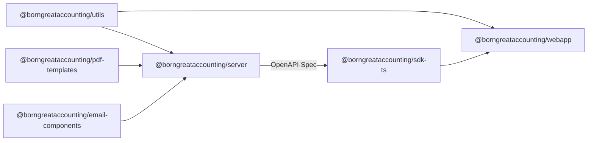

# APPLICATION DEPENDENCIES & MODULE COMMUNICATION MAP

## 1. Cross-Package Dependency Graph

## 2. Backend Internal Module Dependency Map
- **Transaction Posting Pipeline**:
  `SaleInvoices` / `SaleReceipts` / `Bills` / `Expenses` / `PaymentReceived` / `BillPayments` / `ManualJournals` / `InventoryAdjustments`
  $\rightarrow$ `TransactionItemEntry` (validates & persists `items_entries`)
  $\rightarrow$ `InventoryCost` & `Warehouses` (updates `quantity_on_hand`, `items_warehouses_quantity`, and cost lots)
  $\rightarrow$ `Ledger` (writes balanced debit/credit rows to `accounts_transactions`)
  $\rightarrow$ `EventsTracker` / `EventEmitter2` (triggers `Analytics`, `AuditLogs`, `MailNotification`, and `SMS` subscribers).
- **Reporting Pipeline**:
  `FinancialStatements` (Balance Sheet, Profit & Loss, Cash Flow, Trial Balance, AR/AP Aging, Sales by Items)
  $\rightarrow$ Reads `accounts`, `accounts_transactions`, `contacts`, `items_entries`
  $\rightarrow$ Formats table rows (`FinancialSchema`, `FinancialTable`)
  $\rightarrow$ Exports via `PdfTemplate` + `ChromiumlyTenancy` (Gotenberg) or `Export` (CSV/XLSX).
- **External Integrations**:
  - **Email**: `SmtpSettingsService` (tenant DB settings with `.env` fallback) $\rightarrow$ `MailTransporterService` (Nodemailer).
  - **SMS**: `SmsIntegrationSettingsService` (tenant DB settings with `.env` fallback) $\rightarrow$ `SmsService` (**Twilio**, **Hubtel SMS API**, **SMSOnlineGH API v5**) via BullMQ `SMS_QUEUE`.
  - **Payments**: `PaymentServices` (**Stripe**, **Paystack**, **Flutterwave**, **Hubtel**) $\rightarrow$ `PaymentLinks` & `Webhooks`.
