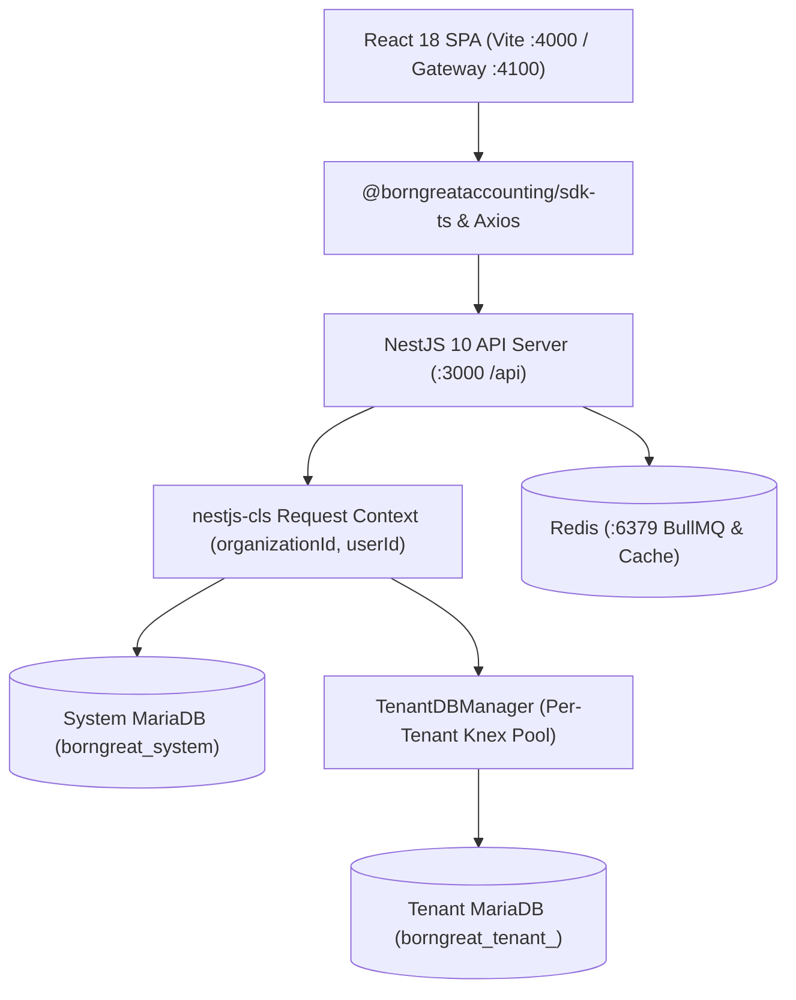

# PROJECT ARCHITECTURE (`BorngreatAccounting`)

## 1. Technology Stack & Build Tooling (Verified from Source)
| Layer | Technology | Evidence / Path |
|---|---|---|
| **Monorepo Orchestration** | `pnpm` Workspaces + `Lerna` v8 (independent versioning) | `package.json`, `pnpm-workspace.yaml`, `lerna.json` |
| **Language** | TypeScript (`5.x`) across all packages | `tsconfig.json` in `packages/*` and `shared/*` |
| **Frontend (`@borngreataccounting/webapp`)** | React 18 SPA, Vite 5 (`vite.config.ts`), BlueprintJS (`@blueprintjs/core`), Redux + `@tanstack/react-query`, React Router v5, Formik + Yup, `styled-components`, SCSS | `packages/webapp/package.json`, `packages/webapp/vite.config.ts` |
| **Backend (`@borngreataccounting/server`)** | NestJS 10 (`@nestjs/platform-express`), Passport JWT, `nestjs-cls`, `class-validator` / `class-transformer`, OpenAPI/Swagger, Native `zlib` gzip response compression | `packages/server/src/main.ts`, `packages/server/package.json` |
| **Database & ORM** | MariaDB / MySQL (`mysql2`), Knex query builder & migrations, Objection.js ORM | `packages/server/src/database/`, `packages/server/src/models/` |
| **Queues & Caching** | Redis + Bull / BullMQ (`@nestjs/bullmq`), ClickHouse (optional analytics), Socket.IO | `packages/server/src/modules/SMS/SMS.processor.ts`, `packages/server/src/modules/Analytics/` |
| **PDF & Email Engines** | Gotenberg (`ChromiumlyTenancy`) + `@borngreataccounting/pdf-templates` (Webpack SSR); `react-email` (`@borngreataccounting/email-components`) + Nodemailer | `shared/pdf-templates`, `shared/email-components`, `packages/server/src/modules/Mail/` |
| **Object Storage** | S3-compatible storage (Garage in dev / AWS S3 in prod) via AWS SDK | `packages/server/src/modules/S3/`, `packages/server/src/modules/Attachments/` |
| **Windows Desktop Runtime** | Native C# Launcher (`BorngreatAccounting.exe`), PowerShell Runtime Manager (`scripts/windows-runtime.ps1`), Web Gateway (`scripts/windows-gateway.js`), Inno Setup 6 (`desktop/windows-installer/BorngreatAccounting.iss`) | `desktop/windows-installer/`, `scripts/` |

## 2. Multi-Tenant & Dual-Database Architecture

## 3. Wire Format & Serialization Pipeline
1. **Database Columns**: `snake_case` in MariaDB.
2. **Objection.js Models & NestJS Services**: `camelCase` in TypeScript.
3. **Global `SerializeInterceptor`** (`packages/server/src/common/interceptors/serialize.interceptor.ts`):
   - **Inbound**: Converts incoming request body & query from `snake_case → camelCase` before DTO validation.
   - **Outbound**: Converts outgoing service response from `camelCase → snake_case` on the wire.
4. **SDK & Webapp**:
   - `@borngreataccounting/sdk-ts` converts outgoing requests to `snake_case` and optionally transforms responses to `camelCase` via `useApiFetcher({ enableCamelCaseTransform: true })`.
   - Legacy `axios` callers use `transformToCamelCase(res.data)`.
